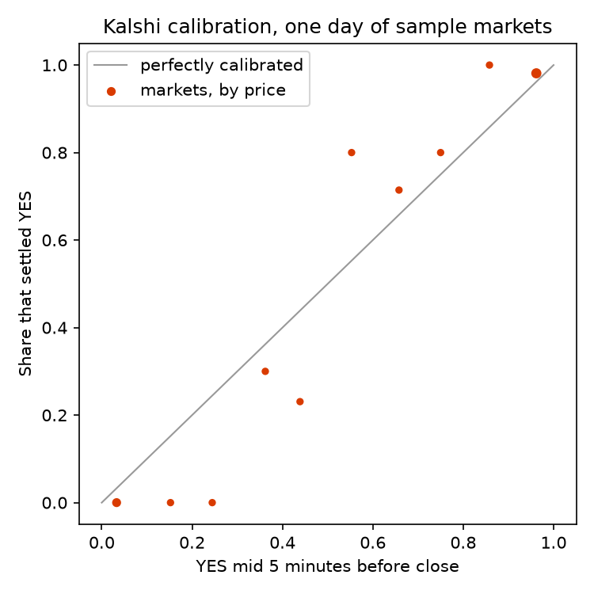

# Kalshi Eye examples

Runnable examples for working with Kalshi order book data from [Kalshi Eye](https://kalshieye.com/).

Every script reads the free one-day sample on Hugging Face in place:
[KalshiEye/kalshi-order-book-sample](https://huggingface.co/datasets/KalshiEye/kalshi-order-book-sample). That sample is October 13, 2026 for seven Kalshi series, with every order book change, trade and settlement. You don't need an account, an API key, or to download anything first. The files and columns are the same as the full archive, so the code runs unchanged on data you download.

## Run them

```bash
git clone https://github.com/KalshiEye/kalshieye-examples
cd kalshieye-examples
pip install -r requirements.txt
python 01_quickstart.py
```

| Script | What it shows |
|---|---|
| [`01_quickstart.py`](01_quickstart.py) | The day's busiest NFL markets: trades, contracts, average price, first and last price. |
| [`02_spread_and_depth.py`](02_spread_and_depth.py) | Time-weighted spread and size at the best bid and ask, hour by hour, for the 15-minute bitcoin markets. |
| [`03_rebuild_order_book.py`](03_rebuild_order_book.py) | Rebuilds the full order book of the Bills vs Rams market from `book_l2` during the game, and checks it against the `bbo` file. |
| [`04_backtest.py`](04_backtest.py) | Buys YES at the ask five minutes before close in every 15-minute crypto market, paying Kalshi's taker fee and skipping hours with recorder gaps. |
| [`05_calibration.py`](05_calibration.py) | Whether contracts priced at p win about p of the time, as a table and a chart. |



## Your own files

Point `KALSHIEYE_DATA` at a folder you downloaded from Kalshi Eye (the folder named `kalshieye-data`), and every script reads that instead:

```bash
export KALSHIEYE_DATA=/path/to/kalshieye-data
```

Reading from Hugging Face without an account works, but heavy use can hit Hugging Face's anonymous rate limit. Setting `HF_TOKEN` to a (free) Hugging Face token lifts it.

## Reading the data

- Prices are dollars between 0 and 1, sizes are contracts, and timestamps are nanoseconds UTC. `ts_recv` is when the recorder received a message; order rows by it.
- Kalshi's books are bids only. A NO bid at p is an offer to sell YES at 1 − p. `bbo`, `bbo_1m` and `book_snap_1s` show asks in YES terms already, while `book_l2` has the raw YES and NO bids (see `Book` in [`kalshieye_sample.py`](kalshieye_sample.py)).
- `incidents` lists every hour the recorder did not see in full. The examples leave those hours out, and so should any test of a trading rule.

Every column is described in the [data dictionary](https://kalshieye.com/docs/datasets/). [How to backtest Kalshi markets](https://kalshieye.com/guides/backtest-kalshi-markets/) walks through example 4 step by step, and [Kalshi vs Polymarket data](https://kalshieye.com/guides/kalshi-vs-polymarket-data/) covers what changes on Polymarket.

## License

The code is MIT licensed. The sample data is CC BY-NC 4.0; see the [dataset card](https://huggingface.co/datasets/KalshiEye/kalshi-order-book-sample). The full archive, recorded since October 12, 2026, is described at [kalshieye.com/data/kalshi](https://kalshieye.com/data/kalshi/).

Kalshi Eye is independent and is not affiliated with Kalshi.
